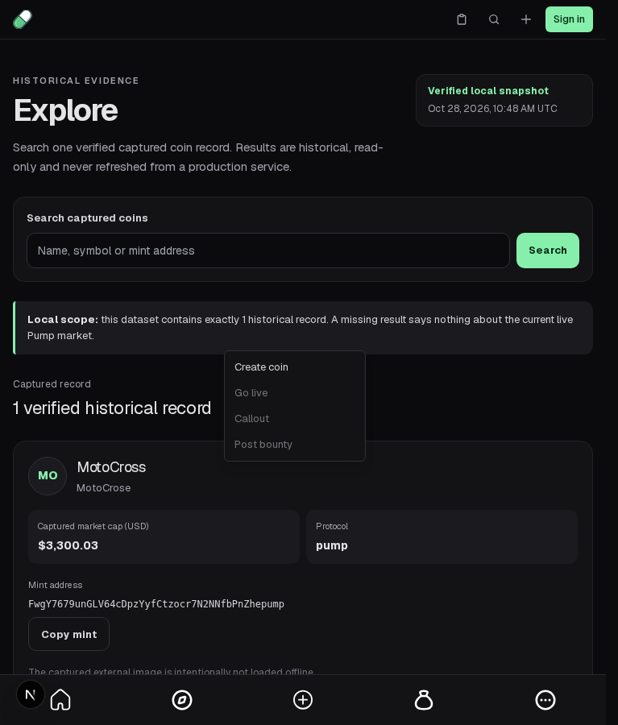
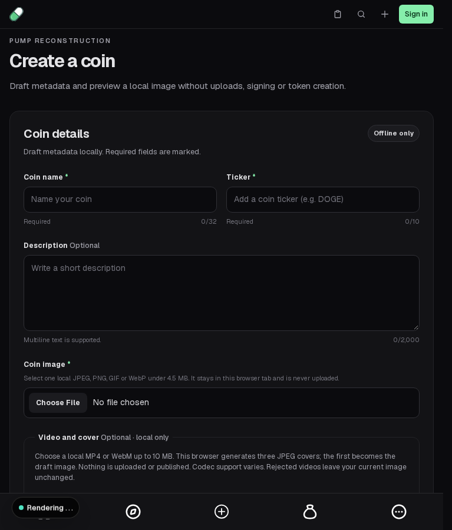

# Close the drawer's popup with its host and restore keyboard focus

The mobile sidebar's Ctrl/Meta+B shortcut closes its drawer without changing its Create dropdown's local open state. The dropdown portal lives in `document.body`, outside the newly inert sidebar. A real shortcut therefore leaves a rendered, focused menu after its host has disappeared. Ordinary menu selection already closes both layers through `onNavigate`; that path is not the defect.

Give only this caller a mobile-drawer lifetime key. Its hidden Create trigger stays rendered with route metadata; its local popup state resets when that host opens/closes. Desktop uses a constant key, preserving the live popup's identity/state across rail toggles. For shortcut closure, use the existing `closeMobile(true)` focus-return path; opening and desktop still call the existing toggle. This restores actual More focus rather than merely removing a focused node. Normal selection retains `closeMobile()` without stealing route focus.

No generic Dropdown, menu placement, Tab behavior, Settings or footer changes. PR #1431 owns mobile placement, #1394 owns Tab continuation and #1300 owns opening-arrow behavior. This local lifetime correction does not claim their work or original open-popup equivalence.

## Actual before and after

Pinned base `381dc30b35122022be7359215cb5d471fe9f778d`, actual local Next on port 3027, no backend service:

- [Unchanged baseline](baseline.log): **1 passed / 1 failed / 1 not run**, workers 1/retries 0/max-failures 1. Normal selection closes menu/drawer and retains Create route metadata. Then the real parent shortcut closes the drawer while the menu remains rendered and focused; the desktop case stops at max-failures.
- [Before shortcut](before-shortcut.json): trusted Ctrl+B, then closed/inert host with `portalPresent=true`, `portalRendered=true`, `focusedRole=menuitem`. No page/console errors. [Before selection](before-selection.json) preserves the already-working close path.
- [Candidate](candidate.log): **3 passed**, the same final test bytes. [After shortcut](after-shortcut.json) records parent closure with no portal and actual focus returning to `Open navigation`; Enter then reopens navigation and Create selection completes. [After selection](after-selection.json) preserves hidden route metadata. The desktop case verifies the same live popup ID and focused menuitem through a rail toggle, then ordinary Escape focus return; [desktop observations](after-desktop.json) are retained.

| Before: active orphan after shortcut | After: complete reopen/selection workflow |
| --- | --- |
|  |  |

The after PNG is the **end of the complete workflow on Create**, not a screenshot of the exact intermediate More-focus step. Ordered observations and executable assertions establish that intermediate portal removal/focus return; a separate same-step after PNG was not captured. [Desktop final view](after-desktop.png) is a local reference. No video was recorded and no animation, placement or pixel-parity improvement is claimed.

The [before source ledger](source-before.json) authenticates nine actual maintained AST witnesses: window shortcut registration, toggle, parent inert boundary, actual `document.body` portal target, local-open condition and selection callbacks. The [candidate ledger](source-after.json) authenticates the used mobile lifetime key, unchanged selection callback and actual focus-return helper/caller. These ledgers are static source evidence, not runtime conclusions; the browser observations are distinct. [work-record.json](work-record.json) binds both source vectors, test bytes and native ordering.

## Repeat

From `app/packages/frontend` with existing pinned dependencies:

```sh
corepack pnpm exec playwright test tests/drawer-popup-lifetime.spec.ts --max-failures=1
corepack pnpm exec next typegen
corepack pnpm exec tsc --noEmit
```

The recorded run uses the normal configuration, an already-running owned Next on port 3027, `baseURL=http://127.0.0.1:3027`, an external output directory, empty developer read key and unused `BACKEND_URL=http://127.0.0.1:3028`. It starts no backend. The server is stopped. The fixture observes the real responsive sidebar attribute before opening an already-mounted drawer; it does not claim a first-prepaint-click correction or replace any app hook/handler. Apply the same test to the pinned base, or restore only the two source preimages in an isolated checkout, to repeat the failure. `source.patch.gz` preserves the exact source overlay (decompress before applying). `baseline.raw.log.gz` retains the exact failing stream; its readable copy strips only trailing line spaces.

From `app`: `node --test tests/shell_integration.test.mjs`, `python3 scripts/verify-evidence.py`, `python3 scripts/progress.py --check`. From root: `python3 scripts/verify_evidence.py`, `python3 scripts/test_tooling.py`. All pass: **3 shell source checks, 9 captures, 10 tooling tests, 698 app objects/npm/unchanged-SDK integrity, progress, typegen and frontend TypeScript**. Latest checked main `b08fd908203a76d84c8dd68b60310582aa2c4fba` retains both exact source preimages.

[MANIFEST.json](MANIFEST.json) binds this packet. Scope is finite 767px mobile/1440px desktop Chromium behavior on the stated cohort. No full production build/browser suite, backend/API or wallet compatibility, original popup semantics, feature milestone or binary qualification. Private conversations/usage and optional run-evidence uploads are outside this contribution; only public-source evidence and synthetic local browser observations are supplied.
