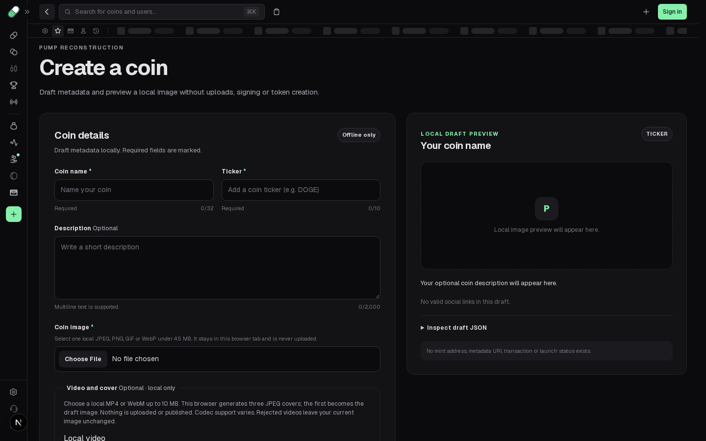

# Restore the captured header Back policy

A direct visit to Create can have no native back entry. The maintained header always calls `router.back()`, leaving that user on Create. It also renders Back on Home, GO and Live. The retained client component instead hides Back on those three exact paths and chooses native Back only when `window.history.length > 1`; otherwise it pushes Home.

Apply that policy in the existing `TopBarControls::BackButton`, using the existing Next router and `usePathname`. There is no new history stack or state manager. Preserve normal previous-entry navigation, the existing button/icon, and all other top-bar controls.

## Original source

[source.json](source.json) authenticates factory **400466** in physical object `evidence/web/objects/13c13db9eb86191b.js`, factory SHA-256 `b55e1d78341162edfc6c5ff1ba32c4b4faa3d0ade6de3a39f440fe39f2e9e5dd`. It records the actual `rD` component, `rM = new Set(["/", "/go", "/live"])`, and both used Back calls inside the actual `aW` header, with raw capture hashes and UTF-16/UTF-8 ranges. The entire selected factory is authenticated, not just a matching text snippet. [source-evidence.mjs](source-evidence.mjs) repeats this through the maintained physical-registration AST reader; captured JavaScript is never executed.

[variant-audit.json](variant-audit.json) preserves the current all-retained-400466 inspection: one variant/origin in this inventory. Selection still uses the explicit physical object and expected factory hash, without assuming numeric IDs are globally unique or asserting a universal runtime winner. These are captured **client-source** operations, not a claim that every retained server HTML or deployment has identical rendering.

## Actual before and after

Exact base: `630a074126a13d4133514d599129c6ac9a3179bc`. One frozen source candidate: SHA-256 `71daedffe62f984c1ec65dcd71bf0974efbdd49fbce552800a87d6d3682d1ff5`. Both phases use identical test bytes, SHA-256 `e9aedf91547cc59162639421dcd57ff217f6d959ca21fd5a1d27544fc65db228`.

- [Unchanged first run](baseline.log): **1 passed / 1 failed / 1 not run**, workers 1, retries 0, max-failures 1. Normal Explore-query → Create → Back already works. The next first-entry test fails; the visibility test does not run.
- [Unchanged visibility run](visibility-baseline.log): the previously stopped case fails at Home, where Back is still present. No product edit precedes either baseline.
- [Frozen candidate](candidate.log): **3 passed**. The native prior-entry control still returns to the retained Explore query. The first-entry control pushes Home and native Back returns to Create, distinguishing push from replace. The third case checks all ten width/path pairs: 1440px and 768px, each at `/`, `/go`, `/live`, `/explore`, `/create`.

[Before first-entry observations](before-entry.json) retain the actual CDP `Page.resetNavigationHistory` and `Page.getNavigationHistory` result: one typed `/create` entry and native `window.history.length === 1`. The real trusted button click leaves the URL on Create. The fixture does **not** replace a history getter, router hook or app handler. [After observations](after-entry.json) retain the same genuine length-one setup and actual ordered navigation: trusted click → Home → native `page.goBack()` → Create. [Before](before-prior.json) and [after](after-prior.json) preserve the prior-entry control; [after visibility](after-visibility.json) records all ten actual DOM counts. Candidate observations contain no page or console errors.

| Before: stuck first-entry Create | After: completed Home-and-back workflow |
| --- | --- |
|  |  |

The after PNG shows the **completed workflow back on Create**, not the intermediate Home step. Ordered native URL observations and executable assertions establish that step; a separate intermediate screenshot was not recorded. [Before Home visibility](before-home-visibility.png) shows the other defect; there is no matching after-Home PNG. No video was recorded and no pixel/animation improvement is claimed.

## Repeat and checks

With the existing pinned dependencies, from `app/packages/frontend`:

```sh
corepack pnpm exec playwright test tests/header-back-history.spec.ts --max-failures=1
corepack pnpm exec next typegen
corepack pnpm exec tsc --noEmit
```

The standard browser command starts its configured local server. The recorded finite run instead used an already-running owned Next on `127.0.0.1:3027`, empty developer read key, unused `BACKEND_URL=http://127.0.0.1:3028`, no backend service, and the exact override in [actual-runtime-config.ts.txt](actual-runtime-config.ts.txt). Its absolute paths identify this checkout; adjust those paths in a separate checkout. The server is stopped. [server.log.gz](server.log.gz) preserves its exact local stream.

To repeat the unchanged failure, apply the same test to the pinned base (or restore just the source preimage in an isolated checkout). [source.patch.gz](source.patch.gz) preserves the exact frozen source overlay; decompress it before applying. Exact baseline streams are in `baseline.log.raw.gz` and `visibility-baseline.log.raw.gz`; the readable copies remove only trailing line spaces.

Other passing commands:

```sh
# From repository root:
python3 scripts/verify_evidence.py
python3 scripts/test_tooling.py
node app/reconstruction/header-back/source-evidence.mjs
# From app:
node --test tests/shell_integration.test.mjs
python3 scripts/verify-evidence.py
python3 scripts/progress.py --check
```

Retained logs show **9 captures, 10 tooling tests, 3 shell source tests, 698 app objects/npm/unchanged-SDK integrity, progress, route type generation and frontend TypeScript PASS**. [work-record.json](work-record.json) binds the source before/after, exact test/config/helper inputs, source corpus anchors and finite scope. [MANIFEST.json](MANIFEST.json) hashes the packet and changed source/test.

Limits: local Chromium at the stated widths/history conditions; no cross-origin history claim, full production build or whole browser suite. No QuickPaste/clipboard activation, excluded token-detail route, backend/API, wallet, binary, SDK, capture or feature-completion change. Private conversations, usage and optional run-evidence uploads are outside this packet; only public-source provenance and synthetic local browser observations are provided.
