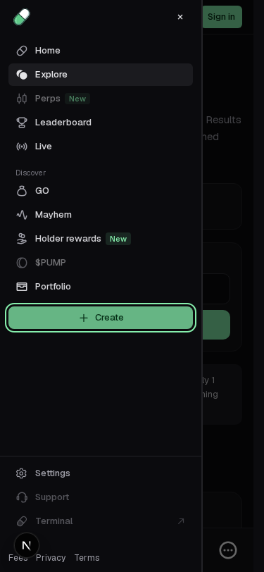

# Escape ownership in the mobile navigation drawer

The reconstructed drawer and its Create dropdown both react to one Escape. The portal menu's existing handler prevents default, closes the menu and focuses its trigger. The drawer's window listener then ignores that consumed event, closes the drawer too and focuses More. This is a reproduced local navigation defect, not a claim about an uncaptured upstream popup.

The correction adds `!event.defaultPrevented` to that existing window handler. The first Escape now belongs to the open menu; the next unhandled Escape closes the drawer normally. No dropdown, Settings, navigation target, captured input or SDK implementation changes. The source condition is separate from PR #1300's dropdown opening-arrow handling and PR #1304's Settings composition handling.

## Actual proof

Base `ef400863f4e476b2eaaab0866c0b1187d8060abc`:

- [Unchanged baseline](baseline.log): **1 failed / 1 not run**, max-failures 1, workers 1/retries 0. After the first Escape, the expected open drawer is closed.
- [Before observation](before-observations.json): the actual event reaches the passive document-bubble observer with `defaultPrevented: true`, target role `menuitem`, text `Create coin` and the drawer still open. After the window handler, the drawer is closed and More owns focus. No page/console errors occur.
- [Candidate](candidate.log): **6 passed**: two new cases at 375px/767px plus existing mobile focus/trap/restoration, Create navigation at 320px/375px and desktop keyboard navigation.
- [After 375px](after-375-observations.json) and [after 767px](after-767-observations.json): the first consumed Escape leaves the drawer open and restores focus to Create; a second unconsumed Escape closes the drawer, releases background inertness and restores More. The query/route stays unchanged. The tests exercise actual keyboard, portal, focus and drawer effects without replacing handlers or network responses.

| Before 375px: first Escape closes both layers | After 375px: first Escape leaves drawer open |
| --- | --- |
|  |  |

[After 767px](after-767.png) is an after-only boundary-width control. The baseline stops at its first 375px failure. No desktop layout changes or desktop visual-parity claim; desktop keyboard navigation is a preservation check. No video is recorded: the executable keyboard walkthrough and native event/focus observations establish the discrete state transition.

The final new test waits for `#app-sidebar[aria-hidden=true]` before opening More. That attribute comes from the provider's real responsive effect, distinguishing an already-mounted menu from an initial prehydration click. The original new 767px attempt failed before any Escape; an existing 320px Create case also failed while the drawer remained closed during setup. Their exact logs remain in `early-767-setup-failure.log.gz` and `early-320-setup-failure.log.gz`, with counts/causes in the work record. The existing Create cases receive the same readiness assertion. Their navigation assertions and all timeouts/retry settings remain unchanged. Formatting also normalizes two existing delayed-Clear expressions without changing behavior. No prehydration-click fix is claimed.

## Repeat

From `app/packages/frontend` with existing pinned dependencies:

```sh
corepack pnpm exec playwright test tests/mobile-menu-escape.spec.ts --max-failures=1
corepack pnpm exec playwright test tests/mobile-menu-escape.spec.ts tests/shell.spec.ts --grep 'Escape closes the nested|mobile navigation traps|Create a coin remains|keyboard traversal reaches' --max-failures=1
corepack pnpm exec next typegen
corepack pnpm exec tsc --noEmit
```

The recorded run used the normal config with an already-started owned server on its normal 3010 port and an external output directory. Before/after use the same new test bytes. To reproduce the failure, apply that test to the pinned base or restore only the base `sidebar.tsx` in an isolated checkout. The exact raw baseline stream is preserved as `baseline.raw.log.gz`; its readable copy strips only trailing line spaces. The server is stopped.

From `app`: `node --test tests/shell_integration.test.mjs`, `python3 scripts/verify-evidence.py`, `python3 scripts/progress.py --check`. From root: `python3 scripts/verify_evidence.py` and `python3 scripts/test_tooling.py`. All pass: **3 shell source checks, 9 captures, 10 tooling tests, 698 app objects/npm/unchanged-SDK integrity, progress, typegen and frontend TypeScript**. Raw outputs are included. Latest main `665499915f9caedcd38921d415a90f0606686398` still has the exact sidebar, dropdown and existing shell-test preimages.

[work-record.json](work-record.json) binds source/test hashes, observed ordering, setup attempts, results and limits; [MANIFEST.json](MANIFEST.json) authenticates the packet. No backend handler changes, production build, complete browser suite, live service/API compatibility, upstream visual equivalence or feature-completion increase is claimed. Private conversations/usage and optional run-evidence uploads are outside this contribution; only public-source provenance and synthetic local browser observations are supplied.
