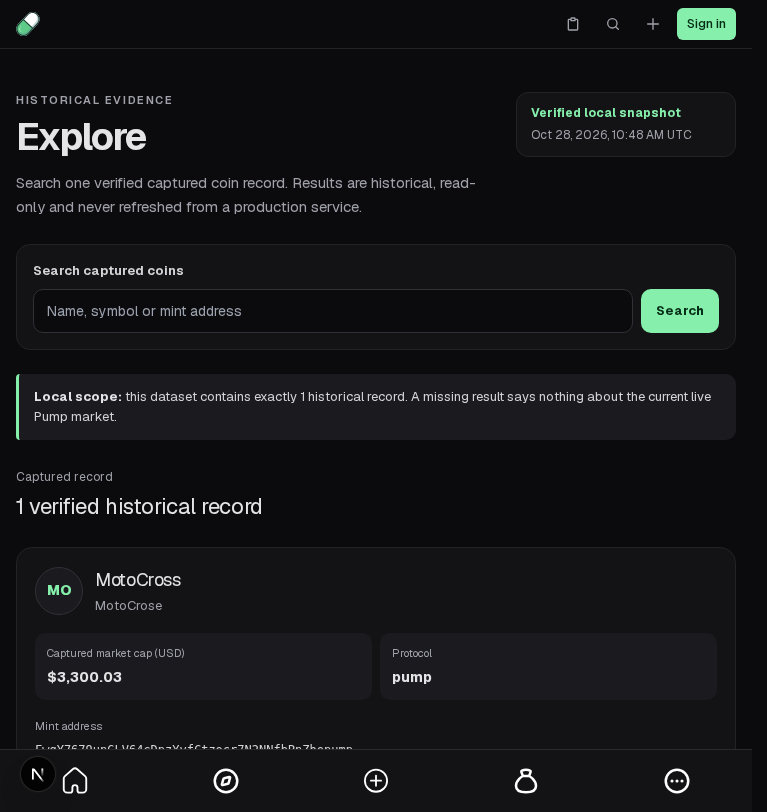
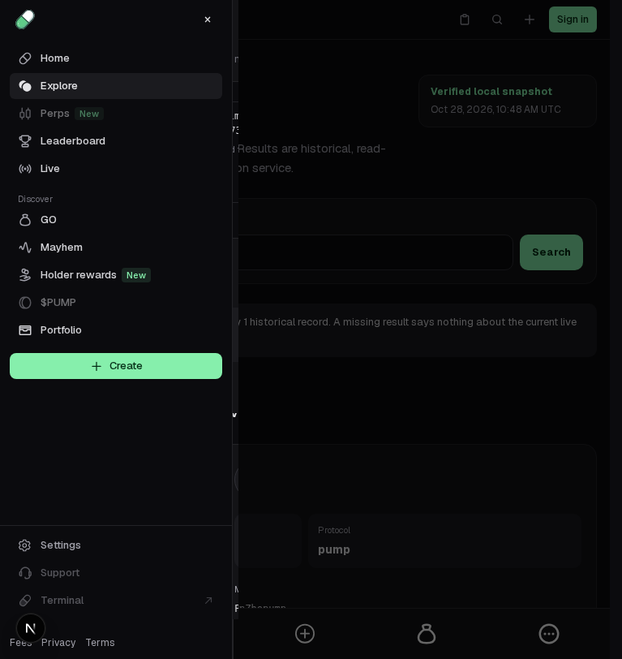

# Offer mobile navigation only when it can handle activation

The maintained More button is visible and enabled in server-rendered mobile navigation before its React handler loads. On unchanged base `665499915f9caedcd38921d415a90f0606686398`, holding only local JavaScript, clicking the offered button once with a real pointer, then releasing boot leaves the drawer closed. The user receives no loading indication and their offered activation is lost.

Use the existing provider's `isMobile` value to mark More natively disabled/busy with `Loading navigation…` and a dim/wait style until that provider is ready. Once enabled, its first offered activation opens the drawer. No new state, context, listener, dependency or data service is introduced. This does **not** queue or replay a click on a disabled control.

The control's `md:hidden` CSS starts hiding it at `min-width:768px`. Both existing provider queries used `max-width:767px`, which leaves a fractional interval between the two definitions. Align the two real toggle/effect queries to `(width < 768px)`, the exact complement of that CSS boundary. Other desktop/tablet controls remain available. This is a **local readiness/responsive correction**, not recovery of original Sidebar prepaint semantics or an auth policy transplanted from another component.

## Actual before and after

- [Final unchanged baseline](baseline.log): **1 failed**, workers 1/retries 0/max-failures 1. [Before observations](before-observations.json) record the enabled control and trusted click before the responsive effect; after boot the drawer remains closed. Only local JS requests are held, with no handler/hook/response replacement.
- [Candidate](candidate.log): **11 passed / 1 skipped**, workers 1/retries 0. Eight discovered new cases cover offered-first activation, ordinary first-click/CPU 4×, five integer widths and a fractional fixture; four existing controls cover mobile focus/trap/restore, Create navigation 320px/375px and desktop keyboard navigation. The skipped case is excluded from the pass count.
- [After observations](after-observations.json): initially disabled, then enabled by the real provider effect, then a single trusted offered click opens the drawer. The identical first-offered test accepts no click while disabled, releases boot, and activates once enabled. The [actual SSR target attributes](ssr-loading.json) independently confirm native disabled, busy and loading title before JavaScript.
- Actual CSS and navigation controls pass at **320,375,767,768,1440px**. Mobile widths expose an enabled More after readiness and support drawer Escape/focus restoration. At 768px/1440px More is hidden while the ordinary desktop sidebar toggle works. The five `control-<width>.json` files and `control-normal-cpu.json` retain their actual observations.

| Before: enabled before boot | After: visibly unavailable during boot |
| --- | --- |
|  |  |

| Before: offered first activation is lost | After: first offered activation opens drawer |
| --- | --- |
|  |  |

The real same-origin iframe has a **767.5px bounding rectangle**, but Chromium rounds its layout viewport to 768: native `min-width:768px` is true, `width <768px` is false and mobile navigation is hidden. [fractional-boundary.json](fractional-boundary.json) preserves the measurements. The test explicitly **skips** this unexercised interval. No fractional runtime, other-engine or upstream embedding compatibility is claimed; the source/CSS complement is statically aligned. `matchMedia`, app hooks and embedded CSS were not mocked.

An earlier natural slow-CPU baseline passed because its actual click followed responsive initialization. It does not prove or disprove a specific setter overwrite. The unproven initial-state-overwrite hypothesis is not presented as the cause. No natural timing grid or repeated first-click attempts were used. Earlier menu setup observations remain separate from this final causal boot proof and from PR #1398's nested Escape correction.

## Repeat and scope

With existing pinned dependencies, from `app/packages/frontend`:

```sh
corepack pnpm exec playwright test tests/mobile-navigation-first-open.spec.ts --grep 'before local boot' --max-failures=1
corepack pnpm exec playwright test tests/mobile-navigation-first-open.spec.ts tests/shell.spec.ts --grep 'More click|More readiness|native fractional|mobile navigation traps|Create a coin remains|keyboard traversal reaches' --max-failures=1
corepack pnpm exec next typegen
corepack pnpm exec tsc --noEmit
```

The recorded runs use the normal configuration with an already-running owned server on port 3010 and an external output directory. That server is stopped. The final first-offered test bytes match before/after; restore only the base's two changed source files in an isolated checkout to repeat the failure. The raw failing stream is retained as `baseline.raw.log.gz`; its readable copy strips only trailing line spaces. No screenshot is an upstream visual-parity reference, and no walkthrough video was recorded. Executable steps, native events, availability and focus observations establish the discrete behavior.

From `app`: `node --test tests/shell_integration.test.mjs`, `python3 scripts/verify-evidence.py`, `python3 scripts/progress.py --check`. From root: `python3 scripts/verify_evidence.py`, `python3 scripts/test_tooling.py`. All pass: **3 shell source checks, 9 captures, 10 tooling tests, 698 app objects/npm/unchanged-SDK integrity, progress, typegen and frontend TypeScript**. React review confirms existing derived state and native availability semantics without new listeners or fetching.

[work-record.json](work-record.json) binds source/test hashes, observations, finite results and limits; [MANIFEST.json](MANIFEST.json) binds this packet. No backend/API, wallet, capture, SDK/dependency, feature-progress milestone or binary changes. No full production build, complete browser suite, original prepaint semantics, specific setter-overwrite cause or fractional execution is claimed. Private conversations/usage and optional run-evidence uploads are outside this contribution; only public-source and synthetic local observations are supplied.
