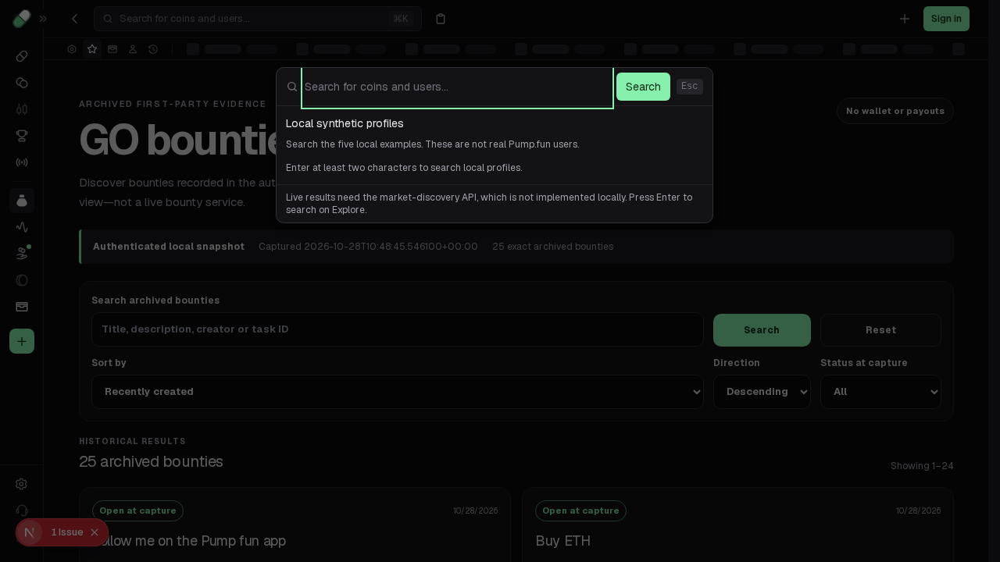
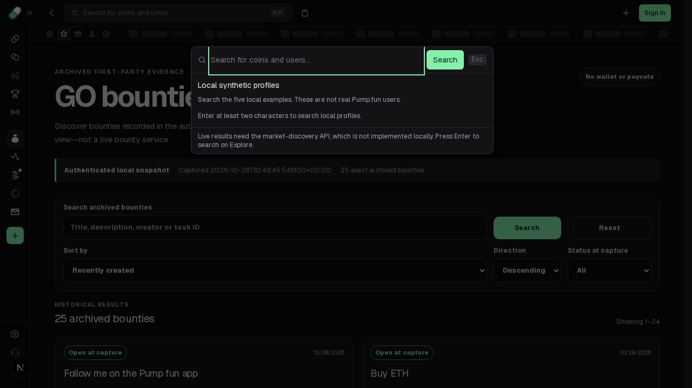

# Stable shared-search hydration during query history

On base `abd766d7a8c047f14af34851f64166b840c6728d`, reload a GO query and press Back before the hidden shared search boundary mounts. Its server-rendered draft still contains the old query, but its initial client draft reads the new empty URL. The first button therefore changes from Clear to Search during hydration. React reports a hydration error and regenerates that boundary. The dialog may look correct after recovery; an eventual input-value assertion misses this failure.

Initialize the draft to an empty string on both server and client. The existing URL effect then applies the current query after mount and continues following Back/Forward. No other query, Clear, shortcut, dialog or result-fetching behavior changes. Latest main `ef400863f4e476b2eaaab0866c0b1187d8060abc` still has the exact tested preimage blob `ebedbdaf55fefed7b343682599143501d42e3352`.

The original captured SearchDialog also uses `[w,_]=(0,a.useState)("")`. [original-initial-draft.json](original-initial-draft.json) authenticates the actual factory 238128 registration, raw capture hash and complete declarator at UTF-16/UTF-8 `[34050,34074)`. This narrow source support does not establish original hook or complete dialog equivalence. Captured JavaScript was parsed, never executed.

## Actual before and after

- [Unchanged baseline](baseline.log): **1 failed / 1 not run**, workers 1, retries 0, max-failures 1. Both `pageerror` and console-error observations contain the same Clear-versus-Search hydration error.
- [Candidate](candidate.log): **17 passed**: two new hydration/history controls and fifteen existing Escape, first-click, shortcut, keyboard, delayed-Clear and local-profile transport/debounce/abort/failure cases.
- [Before timing](before-observations.json) records nonempty server markup, native Back to `/go` before the mounted search listener, then recovery. [After timing](after-observations.json) records the same pre-mount Back with stable empty markup and no page/console errors. [Mobile direct query](after-direct-query-observations.json) still receives `retained` through the URL effect and follows later history.

Earlier probes passed when Forward ran before the hidden boundary mounted. The final regression completes that native Back before moving Forward; it changes no URL, response, hook or app implementation. CPU throttling is 4×, with unchanged repository test timeouts. Its DOM/mount observer is passive. Two unchanged runs then reproduced the same diagnostic; `baseline.log` is the final portable test. The test writes observations and screenshots into Playwright's own output directory.

| Desktop before (React recovered, issue badge) | Desktop after |
| --- | --- |
|  |  |

[After mobile](after-mobile.png) is a direct-query preservation control, not a mobile before/after or pixel-parity claim. The final baseline stopped at its first desktop failure. No video was recorded; the executable steps, ordered observations and raw console error establish the timing defect. No backend behavior changes, so the local request preservation checks supply the relevant transport evidence.

## Repeat

With the repository's existing pinned dependencies, from `app/packages/frontend`:

```sh
corepack pnpm exec playwright test tests/search-dialog-hydration.spec.ts --max-failures=1
corepack pnpm exec playwright test tests/search-dialog-hydration.spec.ts tests/search-dialog.spec.ts tests/search-shortcuts.spec.ts tests/search-local-users.spec.ts tests/shell.spec.ts --grep 'query reload|direct nonempty|Escape dismisses|first search click|bare slash|Ctrl-K|searches the local user|honors two|obsolete rows|closed dialogs|unavailable reads|search encodes queries|keyboard traversal|delayed search clear' --max-failures=1
corepack pnpm exec next typegen
corepack pnpm exec tsc --noEmit
```

The recorded run uses that repository configuration with only an already-started server on its normal port 3010 and an external output directory. The portable test bytes are the same before/after. To reproduce the failure, apply the test to the pinned base or restore only its `SearchDialog.tsx` preimage in an isolated checkout. Do not replace historical evidence.

From `app`, focused source/consumer checks and app integrity:

```sh
node --test tests/search_shortcut_bindings.test.mjs tests/search_shortcuts.test.mjs tests/shell_integration.test.mjs
python3 scripts/verify-evidence.py
python3 scripts/progress.py --check
```

From the repository root:

```sh
python3 scripts/verify_evidence.py
python3 scripts/test_tooling.py
```

All pass: **15 source tests, 9 retained captures, 10 tooling tests, 698 app objects/npm integrity/unchanged SDK, progress, typegen and frontend TypeScript**. Outputs are retained here; `baseline.raw.log.gz` preserves the exact failing stream, while the readable `baseline.log` strips only two trailing end-of-line spaces. [work-record.json](work-record.json) binds the changed source/test hashes and finite results; [MANIFEST.json](MANIFEST.json) binds this packet. No production build, full browser suite, live service/API compatibility, upstream visual parity or feature-completion increase is claimed. Existing captured bytes, SDK sources, prior research and separately published recent-history work remain untouched.
