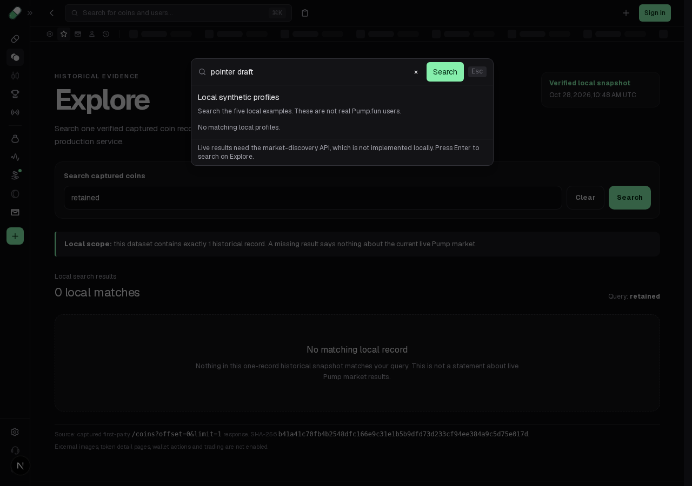
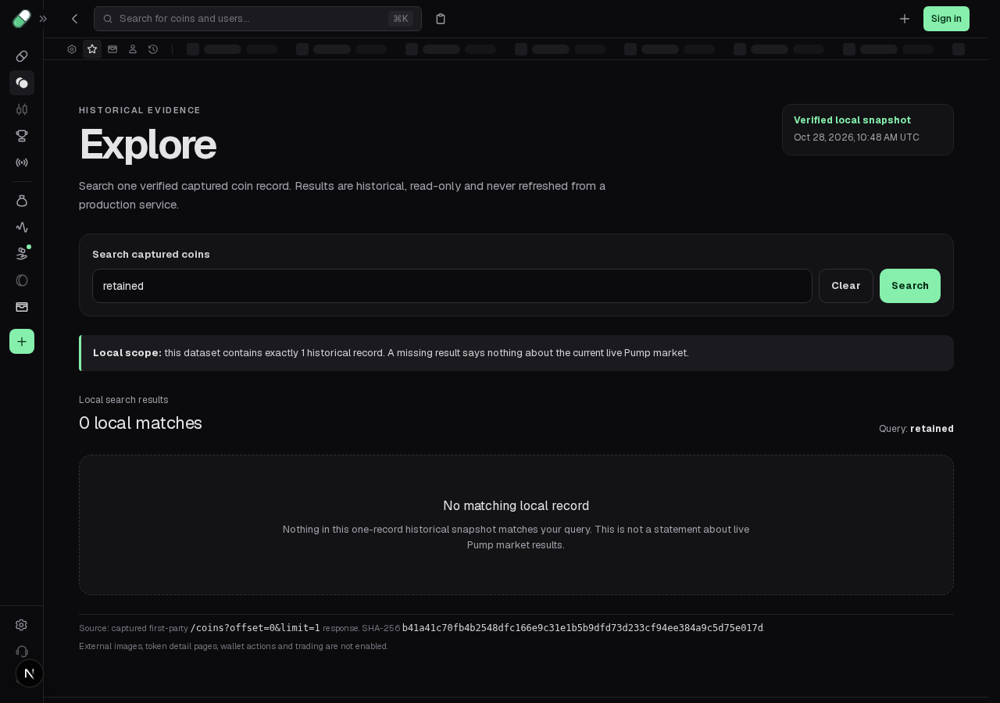

# Restore pointer dismissal for shared Search

Search opens as a native modal, but clicking its backdrop leaves it open. The captured search component's actual responsive-dialog chain admits outside presses and closes Search. Enable that bounded behavior with the native `closedby="any"` attribute on this caller. Browser-native admission preserves inside clicks, an inside-to-outside drag and right-button presses in the measured controls.

The existing maintained draft and Escape behavior stays intact. The original close helper also aborts its request and clears its query/tab before closing; this unit does **not** claim that complete original reset sequence or original runtime/pixel parity. It restores outside dismissal through the maintained native modal.

## Actual used original source

[original-chain.json](original-chain.json) and [repeatable AST verifier](original-chain.mjs) authenticate the selected physical factories and every quoted raw capture/range. Captured JavaScript and getters are parsed, never executed.

| Used boundary | Captured binding |
| --- | --- |
| Search238128 → modal167958 | Actual `ew.N` call forwards `open` and `onOpenChange:es`, with `hideClose:true`. False changes call `ea`. |
| Modal167958 → responsive439587 | The modal wrapper forwards its callback into `a.v`; responsive content actually renders the Backdrop. |
| Responsive Root → DrawerRoot | Uppercase `e.S(...,396623)` exports logical `Root` from namespace524684's `DrawerRoot`. The following `e.i(396623)` consumes that exact grouped export. |
| DrawerRoot → base Root | DrawerRoot defaults `disablePointerDismissal=false` and passes it into grouped660315.Root, defined in the same physical524684 factory before import. |
| Admission → actual close | The used base Root admits topmost primary/single-touch backdrop presses through385676.f. Its actual outside consumer calls `setOpen(false,outsidePress)`. The store forwards the actual onOpenChange callback. |
| Search close → state | `es(false)` calls `ea`, which clears its draft/tab and calls the617614 boolean open setter. That original reset difference remains explicit above. |

Logical396623 and660315 are **grouped export modules**, not additional literal registration factories. Their source was already captured. The pinned runtime's uppercase `S` decoder maps `Root,DrawerRoot` as export name → namespace property; its getter, descriptor writer and shared-cache/import helpers establish registration before import. This avoids treating absence from the literal inventory as missing source or guessing a library default. No inventory, factory/hash count or source-credit milestone changes. The trace is selected-source attribution, not execution of the original deployment or a universal active-variant assertion. Original shipped code retains its authorship.

## Actual before and after

Exact base: `094a06f18df738d41e77070c1a009e135671ac1a`, source SHA-256 `a47fb602cc3a1793f30715fe324bca602ed1b5aeba9768bcdeb6958868057e87`. Its complete app tree is identical to604917c1. One frozen candidate: `d6423d429f017e657cb7e29510e361d75928ba4d2c98fbe483b6d4fb5348ce1a`. Both phases use test bytes `60dc8262833e3b3d78e5869a09f53c7f4808a39e984842f052e6aa49add6751a`.

- [Unchanged baseline](baseline.log): **1 PASS / 1 FAIL / 1 not run**, workers1/retries0/max-failures1. Inside click, real inside-to-outside selection drag and right-button outside press keep Search open. Then a trusted primary backdrop click fails to close it; the touch case stops at max-failures.
- [Frozen candidate](candidate.log): **3 PASS**. The same negative controls stay open. A real desktop backdrop click closes Search, preserves URL and local draft, returns actual opener focus, then Enter reopens and Escape still closes. A real touchscreen-emulated tap at390px also closes Search and reopening retains the local draft.
- [Existing local-search regressions](regressions.log): **5 PASS** without changes: exact local profile navigation, debounce, stale response/abort isolation, closed cancellation/draft retention and failed-read/Enter behavior. These retain their documented controlled clock/fetch fixtures; the three new pointer cases replace no app handler, native method or response body.

[Before outside events](before-outside-final.json) show trusted mouse/button0 outside the actual panel, with the dialog still open. The browser reports native `closedBy="closerequest"`, no attribute and real API support. [After desktop close](after-outside-close.json) records `closedBy="any"`, the actual trusted outside pointerup → cancel → BUTTON focus → close sequence, unchanged `/explore?q=retained` and hidden field `pointer draft`. [Touch close](after-touch-close.json) records trusted `pointerType="touch"` and the same native cancellation/closure. [After inside/drag/right controls](after-inside-final.json) and the final reopen/Escape observations remain attached. Page/console errors are empty.

| Before: after backdrop click | After: after backdrop click and actual focus return |
| --- | --- |
|  |  |

These desktop screenshots show the same workflow step. [Touch after close](after-touch-closed.png) is a separate Chromium touch-emulation observation, not a real-device or matching-before claim. No video was recorded and no visual/animation parity is claimed.

## Repeat and checks

With existing pinned dependencies, from `app/packages/frontend`:

```sh
corepack pnpm exec playwright test tests/search-pointer-dismissal.spec.ts --max-failures=1
corepack pnpm exec playwright test tests/search-local-users.spec.ts --max-failures=1
corepack pnpm exec next typegen
corepack pnpm exec tsc --noEmit
```

The recorded run used an already-running owned Next on `127.0.0.1:3010`, empty developer read key, unused `BACKEND_URL=http://127.0.0.1:3011`, no separate backend service and [this exact override](actual-runtime-config.ts.txt). Adjust absolute checkout paths in another checkout. The server is stopped; [exact local server log](server.log.gz). To repeat the failure, apply the same test to the pinned base or restore only the source preimage in an isolated checkout. [source.patch.gz](source.patch.gz) preserves the exact one-attribute overlay. [baseline.raw.log.gz](baseline.raw.log.gz) retains the exact failing stream; the readable copy removes only trailing line spaces.

From root: `python3 scripts/verify_evidence.py`, `python3 scripts/test_tooling.py`, `node app/reconstruction/search-pointer-dismissal/original-chain.mjs`. From `app`: `node --test tests/shell_integration.test.mjs`, `node scripts/verify-search-shortcuts.mjs --check`, `python3 scripts/verify-evidence.py`, `python3 scripts/progress.py --check`. All pass: **9 captures, 10 tooling tests, 3 shell source tests, original used-chain and unchanged shortcut proofs, 698 app objects/npm/unchanged-SDK integrity, progress, route type generation and frontend TypeScript**.

[work-record.json](work-record.json) binds source/test/config/fixture/type inputs and finite results. [MANIFEST.json](MANIFEST.json) hashes the packet and changed source/test. Limits: Chromium mouse1280px and390px touchscreen emulation; no actual mobile hardware, other browsers/API fallback, nested dialogs, multitouch, scrollbar/provider lifecycle, whole production build or whole browser suite qualification. Separate pending scroll/history/hydration/Clear-focus units are not composed here. No generic dialog, Auth/Settings, backend/API handler, wallet, SDK, original capture, binary or feature-completion change. Private conversations/usage and optional run-evidence uploads are outside this packet.
