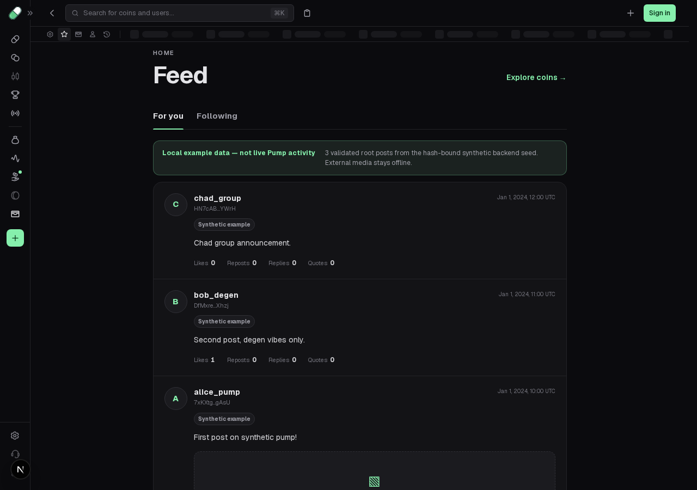
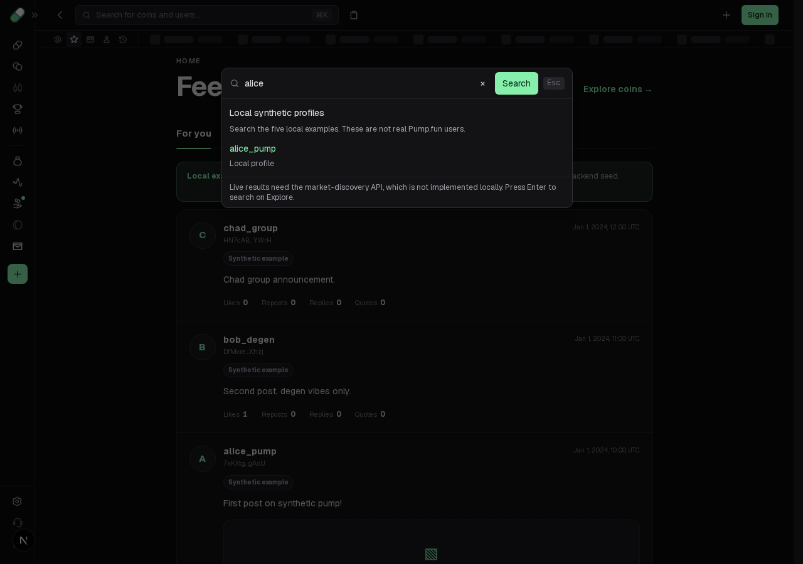

# Keep search open when a profile opens separately

The local profile result passes its modal-close callback to Next Link's `onClick`. Ctrl-click opens the requested profile in a separate tab, but that callback also closes search in the unchanged parent page. This interrupts browsing multiple results even though the current page never navigated.

Bind the existing close callback to `onNavigate`. Next admits current-page navigation before invoking this callback, so ordinary pointer and Enter navigation still close search while modified clicks retain the parent dialog, query and results. The result URL, callback body, local data/read contract and all other search behavior stay the same.

## Maintained source and framework boundary

[source-before.json](source-before.json) and [source-after.json](source-after.json) record exact AST witnesses for the actual result `Link` and its parent `onNavigate={() => dialogRef.current?.close()}` callback. They also bind the installed Next 16.4.1 Link dispatcher, modifier predicate and navigation routine with file hashes and UTF-16/UTF-8 ranges. The dispatcher invokes `onClick` before its modifier early return; `onNavigate` runs after that admission. The installed Link documentation explicitly distinguishes these two callbacks. [source-ledger.mjs](source-ledger.mjs) repeats the static extraction.

This is a **local maintained-UI defect correction**, using the documented framework boundary. It is not a claim about original Pump Ctrl/Meta-click behavior or a new original-client reconstruction milestone. Captures and existing source-contract modules remain unchanged.

## Actual before and after

Exact base: `03fa4494f36449cd8fd63e121f12ca40bf57090f`. Source before SHA-256 `de1b467123ba79cfbbc017fccd908ce252d5f222cbbd8c16f90cb27153ae4878`; sole frozen candidate `3e5ab662ddcf7c55dfd6c12a18ddd8f1ed0abbf96c4b98819f4b7cd3433f3d8b`. Final four-case controller SHA-256 `239a15502a5cb0fba424416a270c96843a2ccf5ad2fb21dbb964019a83876fd4` is identical before and after.

- [Unchanged final baseline](baseline.log): **2 PASS / 1 FAIL / 1 not run**. Ordinary pointer and Enter navigate to the exact local profile and close the dialog. Trusted Ctrl-click creates the exact profile in a separate tab; the parent remains at Home but its search is closed. The Shift case stops at max-failures 1.
- [Frozen candidate](candidate.log): **9 PASS**: the same four new cases plus all five unchanged local-search browser regressions. Ctrl-click and Shift-click keep the parent dialog open with `alice` and its result while the separate child displays the exact profile. Ordinary pointer/Enter still close search. Existing tests cover the exact profile, debounce/length admission, stale response/abort isolation, closed-dialog cancellation/draft retention, and failure/Enter-to-Explore behavior.

[Before Ctrl observations](before-control.json) record trusted `ctrl=true`, native dialog close, actual child creation, child URL `/profile/user-001` and `childHasOpener=false`. [After Ctrl](after-control.json) retains the real parent URL, `open=true`, draft and result; [Shift observations](after-shift.json) preserve the other native separate-window path. Every new case uses real local HTTP: `/api/local-users/search?q=alice` returns 200 with `X-Reconstruction-Data-Source: synthetic-seed-play`, then the actual profile route renders `alice_pump`. The new controller replaces no fetch, router, history, link or app event handler, and records no unexpected origins/writes or page/console errors. The five existing regressions separately retain their documented clock/fetch/error fixtures.

| Before: parent search closes | After: parent search stays available |
| --- | --- |
|  |  |

Both screenshots show the **actual parent after trusted Ctrl-click**, once the separate child has rendered the exact profile. They are the same workflow step. No video was recorded; no pixel or animation parity is claimed.

The [preliminary run](harness-initial.log) passed both normal controls but timed out waiting for the parent page's `popup` event. The actual new tab has no opener. Correcting the fixture to observe the browser context's real page event exposes the application assertion above. This preliminary timeout is preserved, **not counted as application proof**, and no product edit preceded the final baseline. Both failing streams remain exact gzip archives; readable copies remove only trailing line spaces.

## Repeat

With existing pinned dependencies, from `app/packages/frontend`:

```sh
corepack pnpm exec playwright test tests/search-profile-navigation.spec.ts tests/search-local-users.spec.ts --max-failures=1
corepack pnpm exec next typegen
corepack pnpm exec tsc --noEmit
```

The recorded run used an already-running owned Next on `127.0.0.1:3010`, empty developer read key, unused `BACKEND_URL=http://127.0.0.1:3011`, no separate backend service and [this exact override](actual-runtime-config.ts.txt). Its absolute paths identify the recorded checkout; adjust them for a separate checkout. [Exact local server log](server.log.gz). The server is stopped. To repeat the failure, apply the same final test file to the pinned base or restore just the source preimage in an isolated checkout. [source.patch.gz](source.patch.gz) preserves the exact one-prop source overlay.

Other passing checks:

```sh
# From repository root:
python3 scripts/verify_evidence.py
python3 scripts/test_tooling.py
node app/reconstruction/search-profile-navigation/source-ledger.mjs | cmp - app/reconstruction/search-profile-navigation/source-after.json
# From app:
node --test tests/shell_integration.test.mjs
node --test tests/user_search.test.mjs tests/search_navigation.test.mjs
python3 scripts/verify-evidence.py
python3 scripts/progress.py --check
```

Retained logs: **9 captures, 10 tooling tests, 3 shell source tests, 25 search-contract tests, 698 app objects/npm/unchanged-SDK integrity, progress, route type generation and frontend TypeScript PASS**. The source-ledger command compares the current static witness JSON with `source-after.json`. [work-record.json](work-record.json) binds source/test/config/helper/fixture/framework inputs and separates the preliminary and final controllers. [MANIFEST.json](MANIFEST.json) hashes the packet and changed source/test.

Limits: finite Chromium at 1280px with pointer, Enter, Ctrl-click and Shift-click. Meta/macOS, other browser families, middle-button/download behavior, all routes, original modifier equivalence, full production build and full browser suite are unqualified. No backend/API handler, wallet, SDK, capture, binary or feature-completion change. Private conversations/usage and optional run-evidence uploads are outside this packet.
