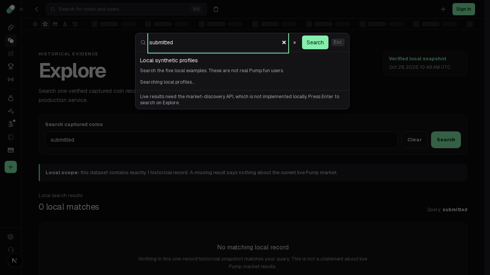

# Preserve a search draft typed during its earlier submission

Submit search, reopen the shared dialog while its route response is pending, and type a new draft. The URL-sync effect then commits the old submitted query over that draft. The existing Clear path already protects edits made during its pending navigation; submission has no corresponding boundary.

Record the actual submission's normalized URL target and raw draft. When that target commits, a functional state update compares the latest draft with the submitted snapshot and retains a changed value. Unedited drafts still normalize to the URL. The ref clears after handling a URL change and on native history navigation, which must continue to follow the URL. No intent is retained when the query value is already current. The existing Clear guard and input change handler remain intact.

## Exact source and runtime

Tested base: `604917c16410d67d9b981305e28e160a93728f50`; source before SHA-256 `a47fb602cc3a1793f30715fe324bca602ed1b5aeba9768bcdeb6958868057e87`. The prior test-only branch at `ccd3330…` was preserved and rebound **before any browser run**; its complete app tree is identical to this base. No older runtime result is relabelled.

Sole frozen candidate SHA-256: `708eb42ae65dd3a7448a04a9013d047991f1170cc786b72b036b017f91cdec77`. The same final three-case test bytes, SHA-256 `91b27c6efed07426b2653046abb43c98c72997a28e842e4160a07a028aac6510`, run before and after.

- [Unchanged baseline](baseline.log): **1 PASS / 1 FAIL / 1 not run**, workers 1, retries 0, max-failures 1. Normal trimmed submission works. The pending submit/reopen/edit case loses `new draft` to `submitted`; the unedited pending case stops at max-failures.
- [Frozen candidate](candidate.log): **3 PASS**. The newer draft survives its earlier submission's actual commit. An unedited raw `  submitted  ` still normalizes to `submitted`; ordinary trim/submit still works. Both delayed cases also assert native Back → `previous` and Forward → `submitted` rather than retaining a stale draft across history.
- [Existing regressions](regressions.log): **2 PASS** without test changes: encoded-query/empty/history behavior and delayed Clear preserving a newly typed draft.

[Before edited observations](before-edited.json) show this actual order: hold the generated target RSC request, reopen and enter `new draft` while the URL is still `q=previous`, continue that request unchanged, receive **200 `text/x-component`**, then observe `q=submitted` and field `submitted`. [After observations](after-edited.json) show the same actual response and committed URL with field `new draft`; subsequent native history controls complete. [Unedited control](after-unedited.json) proves normalization is still applied. The controller delays only the real request using `route.continue()`; it supplies no JSON/body, router hook, history replacement or app handler. Observed page/console errors are empty.

[Source before](source-before.json) binds the five actual maintained AST witnesses: URL query snapshot, submit close/push, input setter, commit effect and native history cleanup. [Source after](source-after.json) adds the real used intent ref and records the changed effect/callers. [source-ledger.mjs](source-ledger.mjs) repeats the extraction without executing captured code. This is a **local URL/draft synchronization correction**, not original Pump asynchronous scheduling or program parity.

| Before: draft replaced after commit | After: complete native history control |
| --- | --- |
|  |  |

The after PNG is **after Back/Forward**, with the canonical `submitted` field. It is not an image of the earlier retained `new draft` step. That intermediate step is established by ordered JSON and executable assertions; a separate matching after-step screenshot was not recorded. No video was recorded and no visual/animation parity is claimed.

## Repeat and checks

With existing pinned dependencies, from `app/packages/frontend`:

```sh
corepack pnpm exec playwright test tests/search-submit-draft.spec.ts --max-failures=1
corepack pnpm exec playwright test tests/shell.spec.ts --grep 'search encodes queries|a delayed search clear' --max-failures=1
corepack pnpm exec next typegen
corepack pnpm exec tsc --noEmit
```

The recorded run used an already-running owned Next on `127.0.0.1:3010`, empty developer read key, unused `BACKEND_URL=http://127.0.0.1:3011`, no separate backend service and [this exact override](actual-runtime-config.ts.txt). Adjust its absolute checkout paths in another checkout. The server is stopped; [exact local server log](server.log.gz). Repeat the failure by applying the same test to the pinned base or restoring only the source preimage in an isolated checkout. [source.patch.gz](source.patch.gz) preserves the exact source overlay. [baseline.raw.log.gz](baseline.raw.log.gz) retains the exact failing stream; the readable copy strips only trailing line spaces.

Other passing checks, from root: `python3 scripts/verify_evidence.py`, `python3 scripts/test_tooling.py`, and `node app/reconstruction/search-submit-draft/source-ledger.mjs | cmp - app/reconstruction/search-submit-draft/source-after.json`. From `app`: `node --test tests/shell_integration.test.mjs tests/user_search.test.mjs tests/search_navigation.test.mjs`, `python3 scripts/verify-evidence.py`, `python3 scripts/progress.py --check`.

Retained logs show **9 captures, 10 tooling tests, 28 shell/search source tests, 698 app objects/npm/unchanged-SDK integrity, progress, route type generation and frontend TypeScript PASS**. [work-record.json](work-record.json) binds the exact source, tests, helpers, config and finite results. [MANIFEST.json](MANIFEST.json) hashes this packet and changed source/test.

Limits: five finite local Chromium cases, not a full production build or whole browser suite. Different-target non-history interleaving, cancelled navigation, same-query whitespace normalization and other browsers remain unqualified. Pending history/hydration/Clear-focus PRs are separate; this receipt qualifies the stated main cohort. No Explore controls, backend/API handler, wallet, SDK, capture, binary or feature-completion changes. Private conversations/usage and optional run-evidence uploads are outside this packet.
